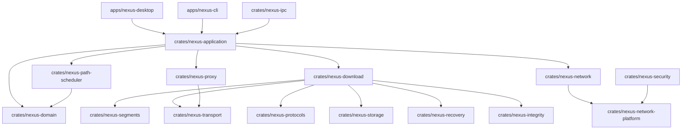

# NEXUS — Software Architecture Document (SAD)

**Document Version:** 1.0  
**Status:** Approved Baseline  
**Architecture:** Modular Monolith  

---

## 1. Architectural Strategy

NEXUS employs a **Modular Monolithic Architecture**. The product is distributed as a single integrated desktop binary (and CLI companion), avoiding distributed systems overhead, while strictly decoupling domain logic, infrastructure, network orchestration, and presentations across 19 internal Rust crates.

### 1.1. Architectural Layers

1. **Presentation Layer:** Native Desktop UI (`apps/nexus-desktop`) and CLI (`apps/nexus-cli`).
2. **Application Layer:** Application use cases (`crates/nexus-application`), IPC (`crates/nexus-ipc`), and automation orchestrators (`crates/nexus-automation`).
3. **Domain Layer:** Core business rules and immutable entities (`crates/nexus-domain`), segment calculators (`crates/nexus-segments`), and path scheduling algorithms (`crates/nexus-path-scheduler`).
4. **Infrastructure Layer:** SQLite database persistence (`crates/nexus-storage`), cryptographic integrity verification (`crates/nexus-integrity`), crash recovery (`crates/nexus-recovery`), and transport abstractions (`crates/nexus-transport`).
5. **Operating System Integration Layer:** OS-specific socket binding, route discovery, and keychain integration (`crates/nexus-network-platform`, `crates/nexus-security`).

---

## 2. Component Dependency Graph

---

## 3. Technology Stack Selection

| Component | Selected Technology | Architecture Decision |
|---|---|---|
| Language | Rust 2021 | Memory safety, zero-cost abstractions, fearless concurrency |
| Async Runtime | Tokio | High-performance multi-threaded asynchronous I/O |
| UI Framework | Native Rust (egui / iced prototype evaluation) | ADR-003: Native UI Framework Evaluation |
| HTTP Transport | reqwest / hyper | ADR-005: HTTP Transport Architecture |
| Database | SQLite via SQLx | ADR-006: Database and Persistence |
| Serialization | Serde + serde_json | Idiomatic schema encoding/decoding |
| Telemetry | tracing + tracing-subscriber | Structured diagnostic events and context propagation |
| Error Handling | thiserror + anyhow | Strongly-typed crate errors, flexible application reporting |
| CLI Framework | clap | Derive-based command-line parsing |
| Checksums | sha2 + blake3 | Cryptographic and high-throughput integrity hashing |
