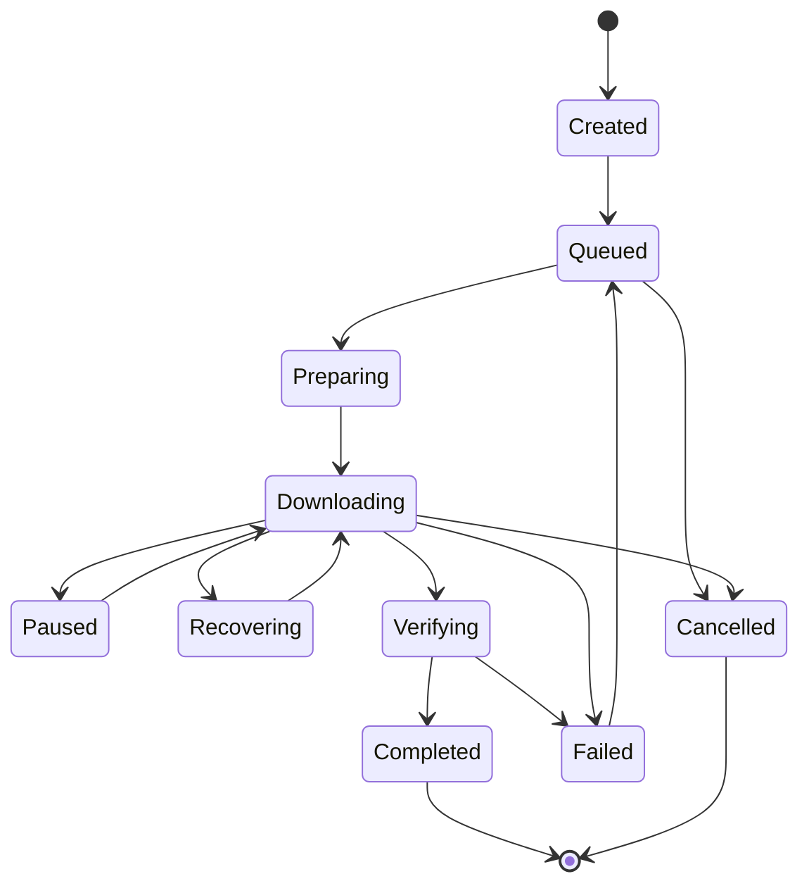

# NEXUS — Technical Design Document (TDD)

**Document Version:** 1.0  
**Status:** Approved Baseline  

---

## 1. Download Lifecycle & State Transitions

A download task transitions through strictly validated states:



State transitions are governed by an explicit finite state machine. Invalid transitions return typed errors (`InvalidStateTransitionError`) and are rejected.

---

## 2. Multi-Connection & HTTP Range Management

### 2.1. Range Partitioning Rules
For a file of size $N$ bytes divided into $K$ segments:
- Segment $i$ covers interval $[S_i, E_i]$ where $S_0 = 0$ and $E_{K-1} = N - 1$.
- For all $0 \le i < K - 1$, $S_{i+1} = E_i + 1$.
- No two committed segment ranges may overlap.
- The total sum of segment byte lengths must equal $N$ exactly.

### 2.2. ETag and Consistency Guards
Before assembling downloaded ranges:
- The server's ETag and Last-Modified headers are verified across requests.
- If an ETag change or HTTP 412 / 200 response (instead of 206 Partial Content) is received during multi-range downloads, the transfer is safely aborted to avoid corrupted file splices.

---

## 3. Direct Multi-Path Networking & Scheduling

### 3.1. Network Path Model
A network path encapsulates:
```rust
pub struct NetworkPath {
    pub id: PathId,
    pub name: String,
    pub interface_id: InterfaceId,
    pub proxy_id: Option<ProxyId>,
    pub priority: u8,
    pub enabled: bool,
    pub limits: PathLimits,
}
```

### 3.2. Weighted Adaptive Scheduling
The scheduler calculates a path quality score:
$$\text{Score} = w_{\text{tput}} \cdot \tilde{T} - w_{\text{lat}} \cdot \tilde{L} - w_{\text{fail}} \cdot \tilde{F} - w_{\text{load}} \cdot \tilde{C}$$
Where:
- $\tilde{T}$ is normalized moving average throughput.
- $\tilde{L}$ is normalized round-trip latency.
- $\tilde{F}$ is failure/retry rate.
- $\tilde{C}$ is active connection ratio.

Hysteresis thresholds prevent erratic path switching.

---

## 4. File Assembly & Crash Resilience

1. Downloads stream into a temporary partial file (`<filename>.<task-id>.part`).
2. Sparse or pre-allocated byte positions are populated using `pwrite`-style random-access file offsets without loading files into memory.
3. Upon receiving all bytes, filesystem buffers are synced (`fsync`).
4. Cryptographic checksums (SHA-256 or BLAKE3) are verified against user or manifest targets.
5. Atomic rename promotes `.part` to the destination filename. If a destination file exists, it is never overwritten without explicit user permission.
